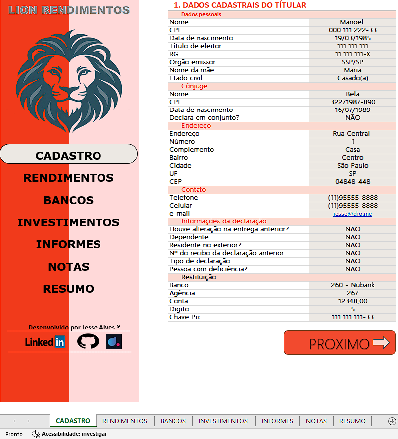
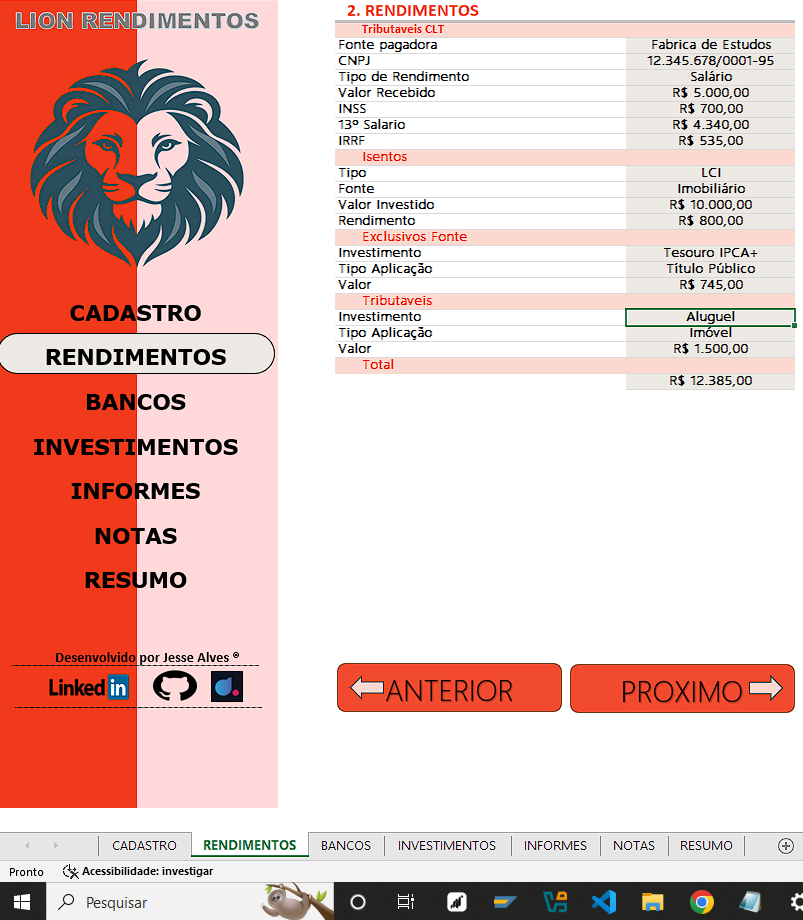
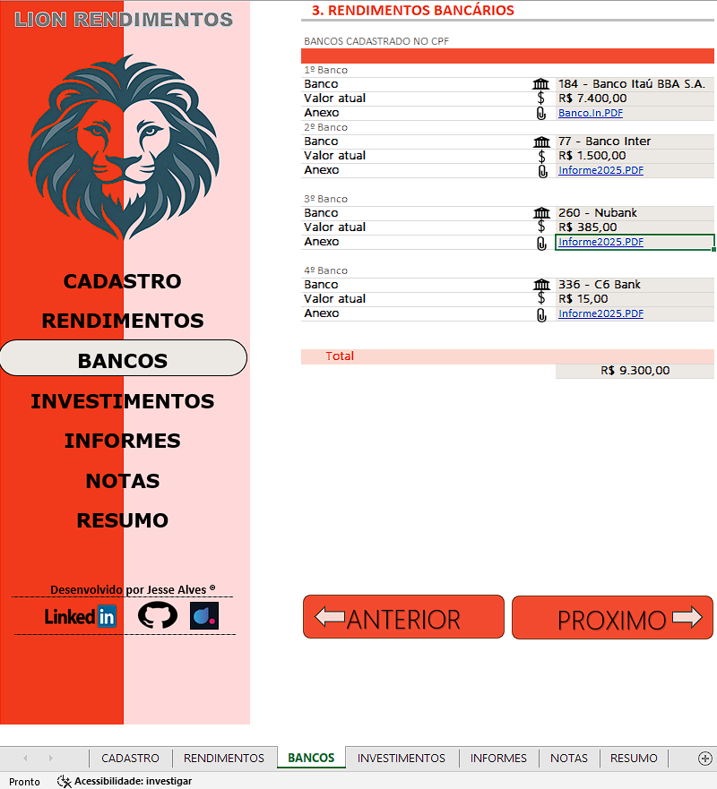
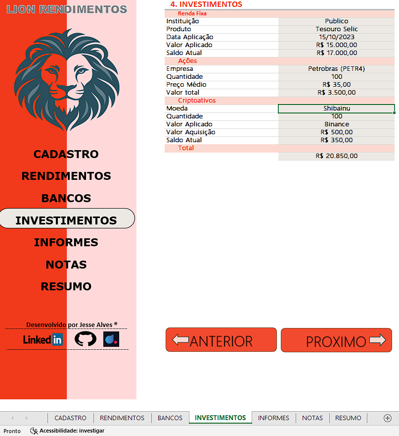
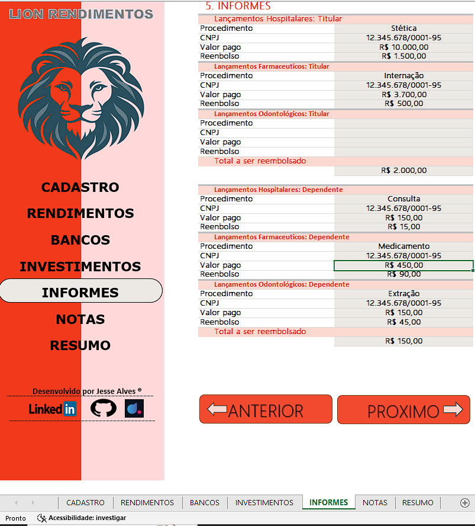
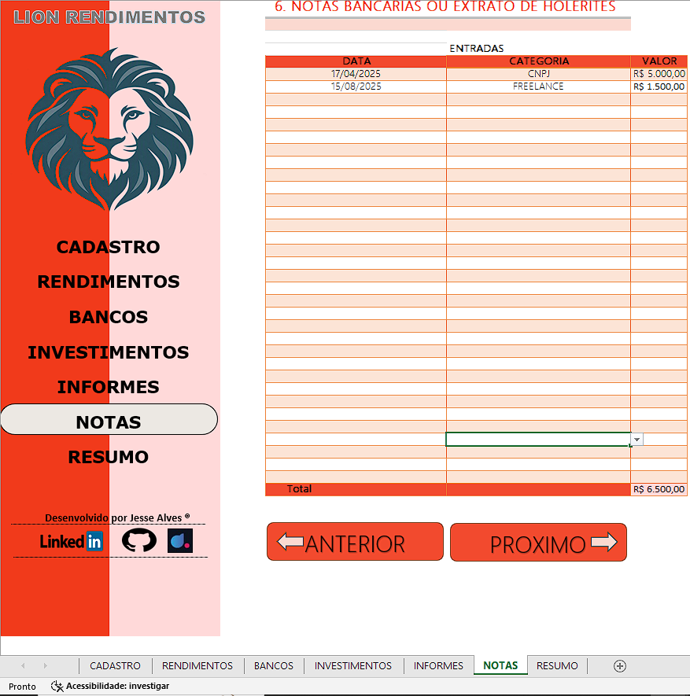
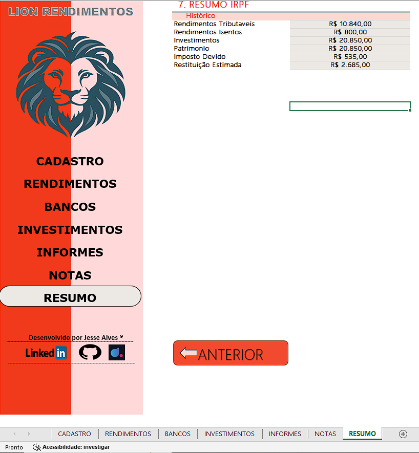

# Organizador de Declaração de Imposto de Renda — Excel

Projeto desenvolvido em Microsoft Excel para organizar informações cadastrais, rendimentos, dados bancários, investimentos e documentos relacionados à preparação da Declaração do Imposto de Renda.

A ferramenta reúne diferentes categorias de informações em um único arquivo, utilizando fórmulas, validação de dados, hiperlinks e automação com VBA para facilitar a organização dos dados e a navegação entre as abas.

## Objetivo do projeto

Desenvolver uma ferramenta prática e intuitiva para centralizar informações em uma planilha Excel, aplicando recursos de organização de dados, cálculos automáticos, validação de informações e automação.

## Funcionalidades

- **Cadastro:** organização das informações cadastrais.
- **Formatação automática de RG com VBA:** código aplicado à célula E8 para remover pontos, hífens e espaços, converter letras para maiúsculas e aplicar a máscara `00.000.000-X`, permitindo um caractere alfanumérico na posição final.
- **Validação de dados:** listas suspensas para seleção da UF emissora do documento e da instituição bancária.
- **Cálculos automáticos:** fórmulas de soma para consolidar valores registrados em diferentes abas.
- **Navegação interna:** links para acessar menus e páginas da própria planilha.
- **Links externos:** atalhos para acessar páginas do LinkedIn, GitHub e DIO.me.
- **Organização de documentos:** links que simulam anexos para facilitar a identificação e o acesso a documentos bancários.
- **Organização por categorias:** informações separadas em abas específicas.
- **Resumo:** visualização consolidada de informações e valores registrados.

## Tecnologias e recursos utilizados

- Microsoft Excel
- Fórmulas e funções de planilha
- Validação de dados
- Hiperlinks internos e externos
- VBA (Visual Basic for Applications)
- Organização e consolidação de dados entre abas

## Demonstração do projeto

A seguir, estão as capturas de tela das principais abas da ferramenta.

### 1. Cadastro

### 2. Rendimentos

### 3. Bancos

### 4. Investimentos

### 5. Informes

### 6. Notas

### 7. Resumo

## Como utilizar

1. Acesse o arquivo Excel disponibilizado neste repositório.
2. Faça o download do arquivo para o computador.
3. Abra-o em uma versão compatível do Microsoft Excel.
4. Navegue pelas abas utilizando os links disponíveis.
5. Preencha os campos e utilize as listas suspensas quando aplicável.
6. Consulte os valores calculados e revise as informações registradas.

## Arquivo do projeto

[**Baixar a planilha Excel**](Projeto_2_Criando_um_organizador_de_declaração_de_imposto_de_renda.xlsx)

## Aprendizados e aplicação prática

Durante o desenvolvimento deste projeto, foram aplicados conhecimentos e recursos relacionados a:

- Estruturação e organização de informações em planilhas.
- Utilização de fórmulas para cálculo e consolidação de valores.
- Criação de listas suspensas com validação de dados.
- Implementação de automação com VBA para formatação de RG.
- Criação de hiperlinks para navegação interna e acesso a páginas externas.
- Organização visual das informações para facilitar a utilização da ferramenta.

O projeto proporcionou a oportunidade de integrar diferentes recursos do Excel em uma solução prática, exercitando a resolução de problemas e a organização de dados.

## Finalidade e limitações

Este projeto possui finalidade organizacional e educacional. A ferramenta auxilia na organização de informações, mas não substitui o programa oficial da Receita Federal, a conferência dos dados pelo contribuinte ou a orientação de um profissional contábil.

Confira sempre as informações registradas e as exigências oficiais vigentes antes de preparar uma declaração.

## Autor

**Jessé Alves**

- [GitHub](https://github.com/jessealves-jpg)
- [LinkedIn](https://www.linkedin.com/in/jessealvesde)
- [DIO.me](https://www.dio.me/)
